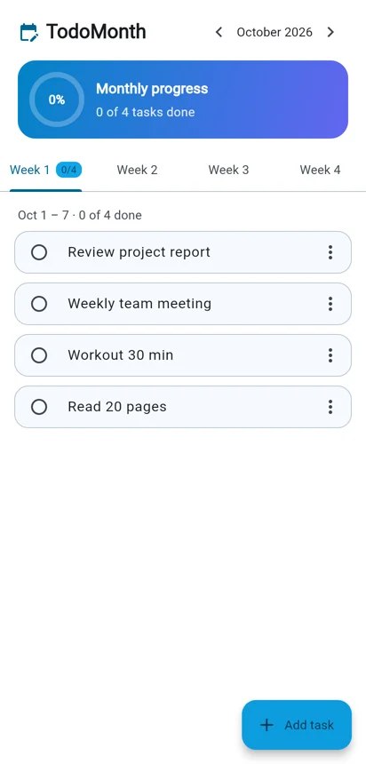
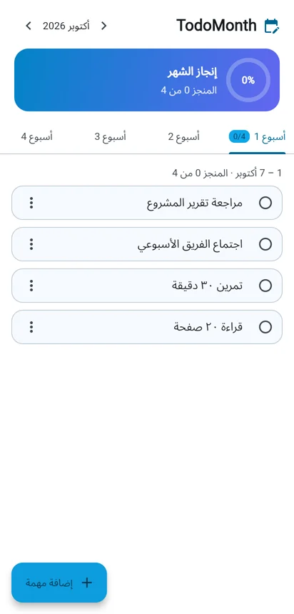
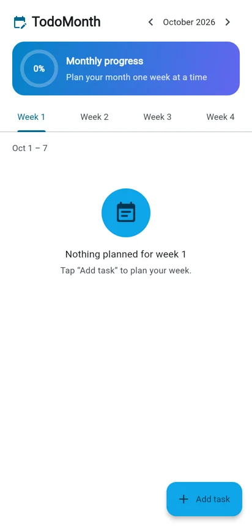

# TodoMonth

A Flutter app for planning a month one week at a time.

**Live demo:** https://mishaltouhiri.github.io/ToDo/

  

| English | العربية | Empty week |
|:---:|:---:|:---:|
|  |  |  |

## Features

- Four week tabs per month, each showing its dates and how many tasks are done
- Monthly progress ring across all weeks
- Add and rename tasks from a bottom sheet; tick to complete
- Delete from the task menu or by swiping, with Undo
- Move between months; every month keeps its own plan
- Tasks are saved on the device (`shared_preferences`)
- Material 3 with light and dark themes
- English and Arabic (right to left), following the device language

## Tech stack

Flutter · Dart · Material 3 · `shared_preferences` · `flutter_localizations` · widget tests · GitHub Actions → GitHub Pages

## Run

```bash
flutter pub get
flutter run          # or: flutter run -d chrome
flutter test
```
